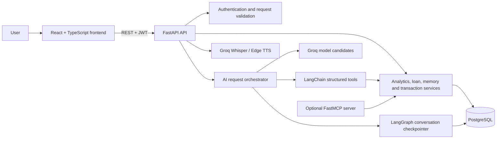
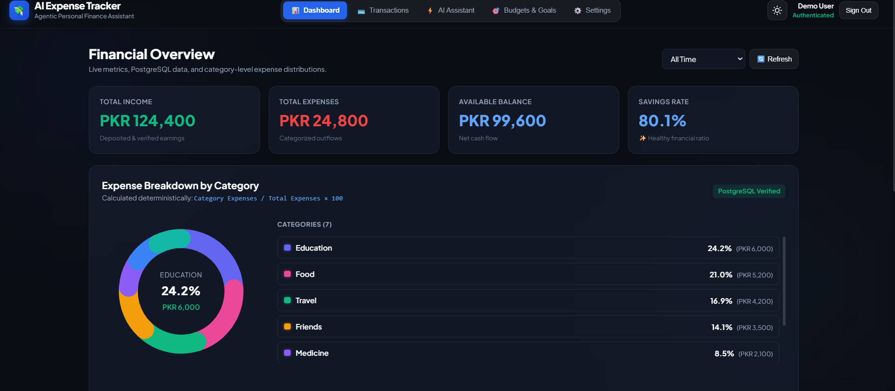
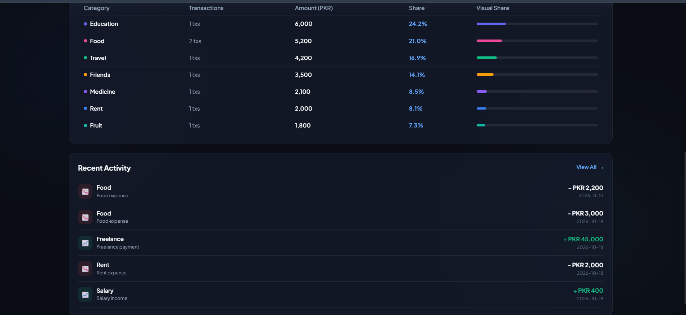
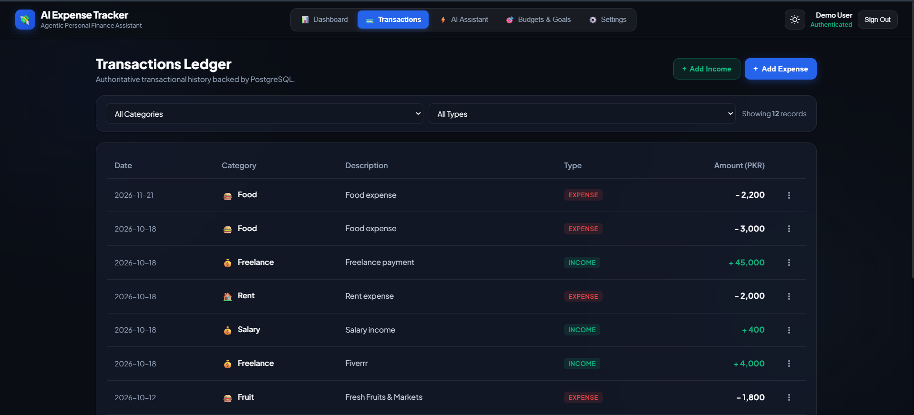
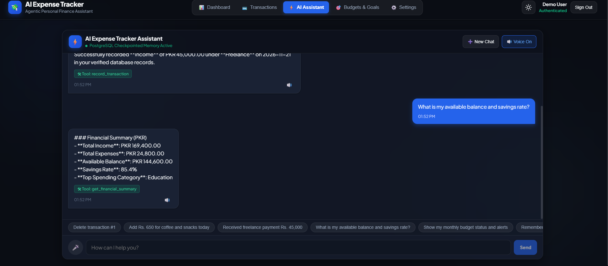
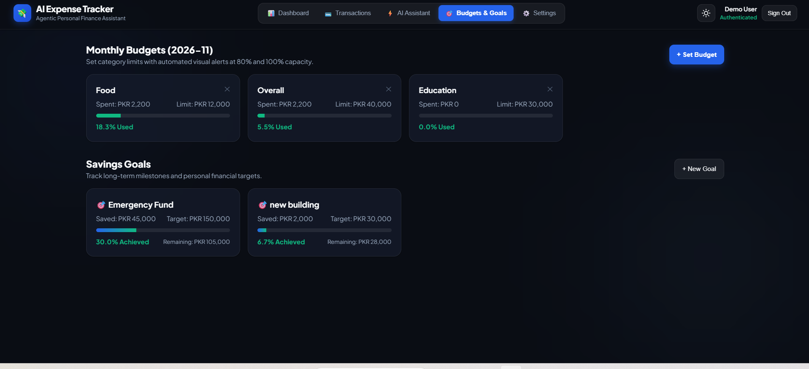

# AI Expense Tracker — Agentic Personal Finance Assistant

[](https://www.python.org/)
[](https://react.dev/)
[](https://fastapi.tiangolo.com/)
[](https://www.postgresql.org/)

An intelligent personal finance application that combines income and expense tracking with a conversational AI assistant. Manage transactions, budgets, savings goals, and money lent or borrowed, then ask the assistant to answer questions or carry out supported financial actions in natural language.

The app stores financial records in PostgreSQL and serves them through a FastAPI backend. The assistant uses structured LangChain tools to connect user requests to backend operations; it does not treat financial actions as generated text. Consequential updates and deletions require confirmation.

## Contents

- [Features](#features)
- [Technology](#technology)
- [Architecture](#architecture)
- [Repository layout](#repository-layout)
- [Requirements](#requirements)
- [Setup](#setup)
- [Configuration](#configuration)
- [Demo account](#demo-account)
- [API overview](#api-overview)
- [Screenshots](#screenshots)
- [Tests](#tests)
- [Security and data handling](#security-and-data-handling)
- [Current limitations and possible next steps](#current-limitations-and-possible-next-steps)
- [Contributing](#contributing)
- [License](#license)

## Features

### Financial dashboard

- Income, expenses, net cash flow (shown as available balance), and savings rate from backend analytics.
- Expense breakdown by category, recent transaction activity, budget progress, and savings goal progress.
- Period selection and a database-backed daily briefing with budget alerts.

The available balance shown here is calculated as income minus expenses for the selected analytics period. It is not a bank balance and the app does not connect to bank accounts.

### Transactions

- Create, view, edit, and delete income and expense records.
- Organize records by category and filter or search the records loaded by the frontend.
- Filter by category, type, date, and amount in the transaction interface.
- Transaction records are kept distinct from personal loans and repayments.

The transaction API supports category, month, type, and limit filters. The current frontend requests a bounded list; it does not provide server-side page navigation.

### People & Loans

- Record money lent and money borrowed separately from income and expenses.
- Track original and outstanding amounts, person-wise history, optional due dates, and active, partially paid, or settled status.
- Record partial or full repayments and view repayment history.
- Require explicit confirmation before loan creation or repayment through the assistant.

Loan records and repayments use their own database tables and do not create ordinary transaction entries.

### Budgets and savings goals

- Create monthly overall or category budgets and view spending, remaining limits, progress, and 80% / 100% alerts.
- Create savings goals with target and current amounts and view progress.
- Delete active or completed savings goals after confirmation.

### AI assistant

The assistant accepts text and voice input. It uses the configured Groq chat model to choose from typed financial tools, and backend services execute those actions against authenticated user data. Supported operations include:

- Create income or expense transactions.
- Retrieve recent transactions, financial summaries, and budget status.
- Propose transaction updates and deletions, which are applied only after confirmation.
- Query personal loan summaries, balances, and history; propose loan creation or repayment with confirmation.
- Save and retrieve durable user preferences or facts.
- Maintain conversation history and per-user checkpoint state.

Example requests:

- “Add 1,200 PKR to my food expenses.”
- “Show my expenses from this month.”
- “How much did I spend on education?”
- “Show the outstanding money I lent to people.”
- “I repaid 500 to Sara for the loan I borrowed.”

The exact interpretation depends on the configured model and conversation context. The assistant uses a local rule-based fallback when model invocation is unavailable; complex language understanding requires a working Groq API key.

## Technology

| Area | Implementation |
| --- | --- |
| Frontend | React 19, TypeScript, Vite, custom CSS and CSS variables, React Markdown |
| Frontend state and routing | React component state; navigation is handled in the app rather than a routing library |
| Charts | Custom SVG expense breakdown; no charting dependency |
| Backend API | Python 3.11+, FastAPI, Pydantic |
| Persistence | PostgreSQL, SQLAlchemy 2, Alembic migrations; decimal `NUMERIC(12,2)` amounts |
| AI | LangChain tool schemas and `ChatGroq`; configured primary and fallback model candidates |
| Conversation state | LangGraph PostgreSQL checkpointer when available, with a `MemorySaver` fallback |
| Authentication | JWT bearer tokens, bcrypt password hashing, optional Google OAuth |
| Optional tool server | FastMCP over Streamable HTTP |
| Voice | Groq Whisper transcription and Edge TTS synthesis |

The current assistant orchestration calls a model with structured tools and executes the selected action in backend code. LangGraph is used for conversation checkpoints; this repository does not define a multi-node LangGraph agent workflow.

## Architecture



For an AI request, the authenticated API supplies the user's identity, preferred currency, saved memories, and conversation context to the orchestrator. The model returns a structured tool call (or a text response); backend code validates and runs supported actions, then returns a response to the client. Sensitive mutations use a confirmation proposal before execution.

FastMCP is an optional, separately started server for exposing finance-related tools to MCP clients. It is not required by the React app's normal REST flow.

## Repository layout

```text
.
├── backend/
│   ├── app/
│   │   ├── agents/        # Tool schemas, orchestration, confirmations and prompts
│   │   ├── analytics/     # Analytics, reports and daily briefing calculations
│   │   ├── api/           # FastAPI routes and request/response schemas
│   │   ├── auth/          # Password/JWT and Google OAuth support
│   │   ├── core/          # Environment-backed settings
│   │   ├── database/      # SQLAlchemy engine, models and sessions
│   │   ├── loans/         # Personal loan and repayment business logic
│   │   ├── mcp/           # Optional FastMCP server
│   │   ├── memory/        # Conversation persistence and checkpointer helpers
│   │   ├── models/        # Groq model selection, retries and fallbacks
│   │   └── voice/         # Speech-to-text and text-to-speech services
│   ├── migrations/        # Alembic configuration and schema revisions
│   ├── tests/             # Backend tests
│   └── main.py            # Backend launch entry point
├── frontend/
│   ├── src/
│   │   ├── components/    # Dashboard-related pages and feature components
│   │   ├── api.ts         # Typed frontend API client
│   │   ├── App.tsx        # Main application and section navigation
│   │   └── index.css      # Theme tokens and responsive styles
│   └── package.json
├── Dashboard/             # Committed UI screenshots
├── requirements.txt       # Python dependencies
├── pyproject.toml         # Python project metadata and dependencies
└── README.md
```

## Requirements

- Python 3.11 or newer.
- Node.js `^20.19.0` or `>=22.12.0` (the Vite version in the frontend lockfile requirement).
- A running PostgreSQL database and credentials. The backend rejects SQLite; the repository does not enforce a specific PostgreSQL server version.
- A Groq API key for model-backed assistant responses and Groq Whisper transcription. Basic non-model fallback behavior is available without it.
- Google OAuth client credentials only if Google sign-in is required.

## Setup

### 1. Clone the repository

```bash
git clone https://github.com/AmirAliShar/ExpensesTrackerAssistant.git
cd ExpensesTrackerAssistant
```

### 2. Configure PostgreSQL and backend environment

Create a PostgreSQL database and user, then copy the root environment template to the backend directory:

```bash
# Run in psql as a database administrator; choose your own credentials.
CREATE DATABASE finpilot;
```

```powershell
# From the repository root (PowerShell)
Copy-Item .env.example backend/.env
```

Edit `backend/.env` with the database name, username, password, and a strong JWT secret. Set `DATABASE_URL` to a PostgreSQL URL, or leave it empty and configure `PGHOST`, `PGPORT`, `PGDATABASE`, `PGUSER`, and `PGPASSWORD`. `PGPASSWORD` is required by the current database module.

```env
PGHOST=localhost
PGPORT=5432
PGDATABASE=finpilot
PGUSER=your_database_user
PGPASSWORD=your_database_password
DATABASE_URL=
JWT_SECRET_KEY=replace_with_a_long_random_secret
GROQ_API_KEY=your_groq_api_key
```

### 3. Install and start the backend

From the `backend/` directory:

```powershell
cd backend
python -m venv .venv
```

Activate the virtual environment, then install the repository's Python requirements:

```powershell
# Windows PowerShell
.\.venv\Scripts\Activate.ps1
python -m pip install -r ..\requirements.txt
```

```bash
# macOS / Linux, from backend/
source .venv/bin/activate
python -m pip install -r ../requirements.txt
```

Apply database migrations, then launch the FastAPI application:

```bash
alembic upgrade head
python main.py
```

The API runs at `http://localhost:8000`. FastAPI's interactive docs are at `http://localhost:8000/docs`; its OpenAPI schema is at `http://localhost:8000/openapi.json`. Startup also calls SQLAlchemy `create_all()` for current models and seeds a demo account if one does not already exist.

### 4. Install and start the frontend

Open a second terminal:

```bash
cd frontend
npm ci
npm run dev
```

Vite prints the local frontend URL (normally `http://localhost:5173`). The API client defaults to `http://localhost:8000`. To point it elsewhere, create `frontend/.env.local` with:

```env
VITE_API_BASE_URL=https://your-api-host
```

### 5. Optional FastMCP server

With the backend environment configured and PostgreSQL available, start a separate process:

```bash
cd backend
python -m app.mcp.server
```

The server uses Streamable HTTP on port `8001` and the configured MCP URL defaults to `http://localhost:8001/mcp`.

## Configuration

The supported environment template is [`.env.example`](.env.example). Copy it to `backend/.env`; do not commit populated environment files.

| Variable | Purpose |
| --- | --- |
| `PGHOST`, `PGPORT`, `PGDATABASE`, `PGUSER`, `PGPASSWORD` | PostgreSQL connection settings; password is required |
| `DATABASE_URL` | Optional full PostgreSQL URL; takes precedence over the individual connection fields |
| `JWT_SECRET_KEY`, `JWT_ALGORITHM`, `ACCESS_TOKEN_EXPIRE_MINUTES` | JWT signing and expiration settings |
| `GROQ_API_KEY` | Groq chat model and speech transcription access |
| `PRIMARY_CHAT_PROVIDER`, `PRIMARY_CHAT_MODEL`, `GROQ_FALLBACK_MODELS` | Model provider and candidate order |
| `MODEL_MAX_RETRIES`, `MODEL_TIMEOUT_SECONDS` | Model call retry and timeout settings |
| `GROQ_STT_MODEL`, `TTS_PROVIDER`, `TTS_MODEL` | Voice service configuration |
| `GOOGLE_CLIENT_ID`, `GOOGLE_CLIENT_SECRET`, `GOOGLE_REDIRECT_URI`, `FRONTEND_URL` | Optional Google OAuth setup |
| `CORS_ORIGINS` | Comma-separated allowed browser origins |
| `MCP_SERVER_PORT`, `MCP_SERVER_URL` | MCP-related settings (the current server launch uses port 8001) |
| `AGENT_PROMPTS_FROM_ENV`, `FINANCE_SUPERVISOR_PROMPT`, `EXPENSE_AGENT_PROMPT`, `BUDGET_AGENT_PROMPT`, `ANALYTICS_AGENT_PROMPT`, `MEMORY_AGENT_PROMPT`, `VOICE_AGENT_PROMPT` | Optional prompt overrides; defaults live under `backend/app/agents/prompts/` |

Create a Groq API key in the Groq developer console if you want model-backed chat or transcription. For Google sign-in, create OAuth credentials in Google Cloud and register the same callback URL as `GOOGLE_REDIRECT_URI`.

## Demo account

On startup, the backend creates a demo account and sample records if `demo@antigravity.io` is not present:

- Email: `demo@antigravity.io`
- Password: `password123`

These credentials are for local demonstration only. Change or remove the seeded demo account and use a strong `JWT_SECRET_KEY` before exposing an instance to other users.

## API overview

Except for registration, login, OAuth entry/callback, and `/health`, API routes require the authenticated user's bearer token. The frontend stores the token and sends it with API requests.

| Area | Methods and paths | Authentication | Purpose |
| --- | --- | --- | --- |
| Health | `GET /health` | No | Service status |
| Auth | `POST /api/auth/register`, `POST /api/auth/login` | No | Create an account or obtain a token |
| Auth | `GET /api/auth/google/start`, `GET /api/auth/google/callback` | OAuth flow | Optional Google sign-in |
| Profile | `GET /api/auth/me` | Yes | Current account |
| Transactions | `GET`, `POST /api/transactions`; `PUT`, `DELETE /api/transactions/{tx_id}` | Yes | List/filter and manage transactions |
| Analytics and reports | `GET /api/analytics/summary`, `GET /api/reports/monthly`, `GET /api/reports/csv`, `GET /api/briefings/daily` | Yes | Summaries, exports, and briefing |
| Budgets | `GET`, `POST /api/budgets`; `DELETE /api/budgets/{budget_id}` | Yes | Read, create, and delete budgets |
| Savings goals | `GET`, `POST /api/goals`; `DELETE /api/goals/{goal_id}` | Yes | Read, create, and delete goals |
| Personal loans | `GET /api/loans`, `/api/loans/summary`, `/api/loans/balance`, `/api/loans/{loan_id}/history`; `POST /api/loans`, `/api/loans/{loan_id}/repayments` | Yes | Loans and repayment history; writes require confirmation |
| AI assistant | `POST /api/agent/query`, `POST /api/agent/query/stream`, `POST /api/agent/confirm`; `GET` / `DELETE /api/agent/history` | Yes | Chat, confirmation, and history |
| Conversations | `GET`, `POST /api/conversations`; `PATCH`, `DELETE /api/conversations/{conversation_id}` | Yes | Persist and manage conversations |
| Memories | `GET`, `POST /api/memories`; `DELETE /api/memories/{memory_id}`, `DELETE /api/memories` | Yes | Manage durable assistant memories |
| Voice | `POST /api/voice/transcribe`, `POST /api/voice/synthesize` | Yes | Speech-to-text and text-to-speech |

Interactive API documentation is available at `/docs` while the backend is running. The optional MCP server exposes tools over its separate Streamable HTTP endpoint rather than under `/api`.

## Screenshots

The repository includes five captures in [`Dashboard/`](Dashboard/). They show the earlier six-item navigation, before the current four-section navigation was introduced; page examples remain useful for the visual design but do not represent the current nav labels.

| View | Capture |
| --- | --- |
| Dashboard overview |  |
| Expense breakdown and recent activity |  |
| Transactions |  |
| AI assistant |  |
| Budgets and savings goals |  |

There is no People & Loans screenshot or live demo link in the repository at this time.

## Tests

Run backend tests from the `backend/` directory with the virtual environment activated:

```bash
python run_tests.py
```

Or run pytest directly:

```bash
pytest -v tests/
```

Some database-backed tests use the configured PostgreSQL connection, so PostgreSQL and `backend/.env` must be available for the full suite. Build the frontend with:

```bash
cd frontend
npm run build
```

## Security and data handling

- Passwords are hashed with bcrypt; authenticated API calls use JWT bearer tokens.
- Financial records are queried with the authenticated user ID. Personal loans and repayments are stored separately from ordinary transactions.
- Request and response bodies use Pydantic schemas, and monetary database fields use PostgreSQL `NUMERIC(12,2)`.
- Google OAuth is optional and validates the returned ID token and nonce.
- Destructive assistant operations use confirmation proposals before mutation.
- Configure a strong, unique `JWT_SECRET_KEY`, restrict `CORS_ORIGINS`, protect database credentials, and use HTTPS in deployments. The application has not been independently audited or hardened for production.

## Current limitations and possible next steps

- Savings goals can be created, viewed, and deleted, but the current API has no goal update endpoint and the frontend does not expose goal editing or contribution updates. Although the database supports a target date, the current goal form does not collect it.
- Transactions are loaded in a bounded list and filtered client-side; server-side pagination is not implemented.
- The committed screenshots predate the current navigation update, and the repository does not include a deployed demo.

## Contributing

Contributions are welcome. For a change, open an issue describing the problem or proposal, keep backend changes tenant-scoped, and include or update tests for changed behavior. Run the relevant backend tests and `npm run build` before opening a pull request.

## License

No license file is currently included. Contact the repository owner for permission before redistributing or reusing this project.
